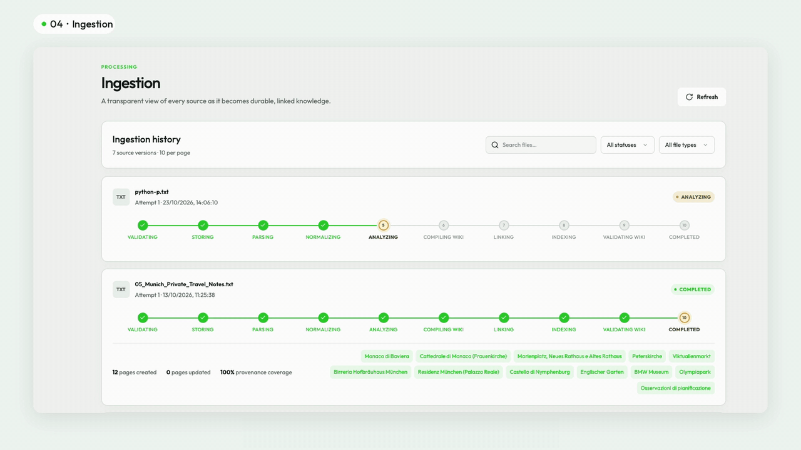
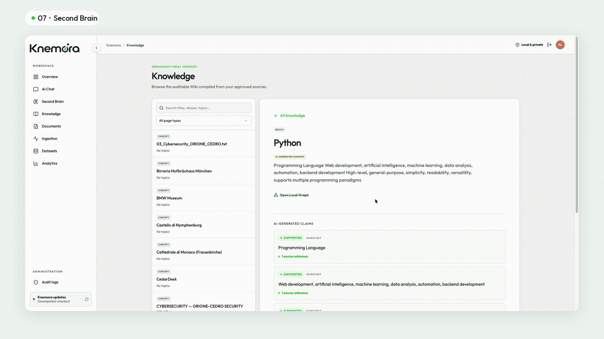
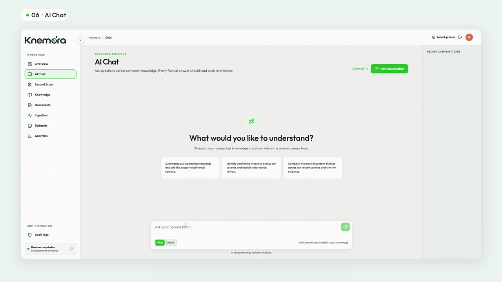
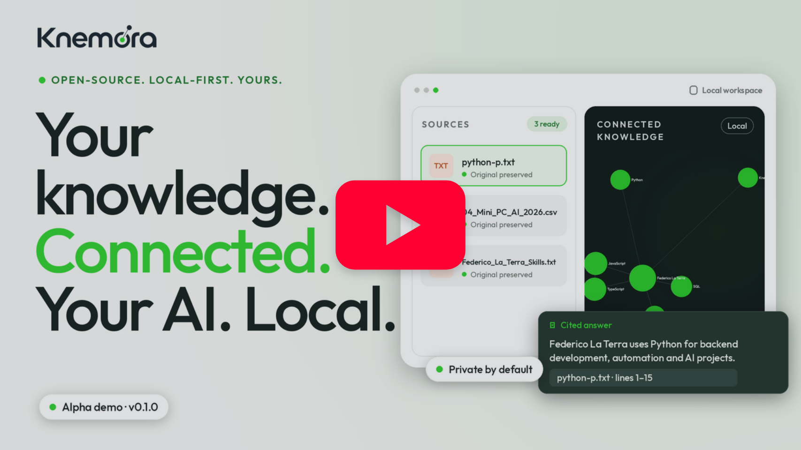

<div align="center">

<p align="center">
  <a href="https://knemora.space#gh-dark-mode-only">
    
  </a>
  <a href="https://knemora.space#gh-light-mode-only">
    
  </a>
</p>

### Open-source, local-first AI (SI) Second Brain

<p>
  
  
  
  <br>
  
  
  
</p>

Turn documents and data into an organized, searchable, connected knowledge base. Knemora builds a
portable Markdown Wiki and native knowledge graph, then uses local models to answer questions with
citations to your sources.

**Available now for macOS Apple Silicon; additional platforms are planned.**

[Quick Start](#quick-start) · [Try the Demo](#try-the-quick-demo) ·
[Documentation](#explore-the-documentation) · [Watch Demo](#watch-the-full-demo)

</div>

> [!NOTE]
> Knemora is still in alpha. The founder is actively improving the project and adding features
> toward the stable `v1.0.0` release.

## What is Knemora?

Knemora keeps your source material, operational data, compiled Wiki, and model runtime under your
control. It ingests PDF, TXT, Markdown, DOCX, CSV, and XLSX files; preserves immutable originals and
claim-level provenance; and connects the resulting knowledge through standard Markdown links.

```text
documents + data → knowledge compilation → Markdown Wiki → Second Brain graph → cited answers
```

Private inference runs locally through llama.cpp. No hosted LLM API, vector database, licensing
server, subscription, or telemetry service is required. Optional Direct-mode public web search is
an explicit network boundary and never gives Wiki mode public-search access.

## Explore the documentation

| Get started | Explore Knemora | Operate and develop |
| --- | --- | --- |
| [Quick Demo](docs/demo/development-preset.md) | [AI (SI) Chat modes](docs/open-source/chat.md) | [Architecture](docs/open-source/architecture.md) |
| [Installation](docs/open-source/installation.md) | [Knowledge Engine](docs/open-source/knowledge-engine.md) | [Security & Privacy](docs/open-source/security.md) |
| [Models](docs/open-source/models.md) | [Second Brain & Wiki](docs/open-source/wiki.md) | [Backup & Restore](docs/open-source/backup-and-restore.md) |
| [Ingestion & Provenance](docs/open-source/ingestion.md) | [Local Inference](docs/open-source/local-inference.md) | [Upgrading](docs/open-source/upgrading.md) |
|  | [Knowledge Updates & Recompilation](docs/open-source/knowledge-updates-and-recompilation.md) | [Development](docs/open-source/development.md) |

See the [complete documentation index](#documentation-index) for additional guides.

## See Knemora in action

### Document ingestion

Upload sources and follow each validation, parsing, analysis, Wiki compilation, linking, and
indexing stage. Completed jobs show the knowledge pages created from the source.



### Knowledge and Second Brain

Browse generated knowledge pages, inspect supported claims and their source references, and move
through the same connected Markdown knowledge that powers the native Second Brain graph.



### AI (SI) Chat

Ask questions across authorized company knowledge. In Wiki mode, factual answers can be grounded
in the compiled knowledge base and linked back to evidence.



### Watch the full demo

<a href="https://www.youtube.com/watch?v=kl5qNrWPOnY" target="_blank" rel="noopener noreferrer">
  
</a>

<a href="https://www.youtube.com/watch?v=kl5qNrWPOnY" target="_blank" rel="noopener noreferrer">Watch the Knemora demo on YouTube</a>.

## Quick start

### Requirements

Managed installation currently supports **native macOS on Apple Silicon with Metal**. Windows,
Linux, and Intel macOS adapters are planned but are not supported in this release.

- Node.js 24 or newer with npm
- Git for the documented clone route
- At least 7 GB of free disk space for the default model, runtimes, packages, and working data

Knemora manages its own uv, CPython, llama.cpp, locked application dependencies, and selected
model. Initial setup needs network access to download them; prepared private local operation does
not require a hosted service.

### Set up and start — only two Knemora commands

```bash
git clone https://github.com/federicolaterra/knemora.git
cd knemora
./knemora setup
./knemora start
```

Setup verifies the host, installs application-owned runtimes and dependencies, downloads and
validates the selected model, initializes SQLite, and applies migrations. Start launches the local
model server, API, and web app. When startup reports `READY`, open <http://localhost:5173>.

For prerequisites, first-run credentials, lifecycle commands, recovery, and safe uninstall, see
the [Installation guide](docs/open-source/installation.md).

### Try the Quick Demo

Explore Knemora with fictional, synthetic example knowledge before uploading personal documents:

```bash
./knemora start --with-presets
```

The isolated Northstar Labs demo contains 120 connected, provenance-bearing Wiki pages. It uses a
dedicated database and data roots, leaves normal data untouched, and is intentionally read-only for
uploads, compilation changes, and dataset analysis. See [Quick Demo — Synthetic Data](docs/demo/development-preset.md).

## Portable backups

Full backups default to `~/Documents/Knemora/Backups/` and contain a consistent SQLite snapshot,
the Markdown Wiki, immutable sources and attachments, dataset artifacts, a checksummed inventory,
and portable model configuration. GGUF model files and secrets are excluded.

```bash
./knemora backup
./knemora backup --db-only
./knemora backups
./knemora restore BACKUP_ID_OR_ARCHIVE_PATH
```

Full backup briefly pauses managed writers and publishes only a validated archive. Restore validates
and stages the complete archive, creates an external recovery backup, and then replaces active data
with rollback protection. Protect backup media independently because it contains private source and
database content. See [Backup & Restore](docs/open-source/backup-and-restore.md) for destinations,
cross-computer restore, database-only limitations, and deletion.

## Uninstall

Uninstall is deliberately guarded and always requires an explicit `y` or `yes` in an interactive
terminal. The global `--yes` flag cannot bypass that confirmation.

```bash
./knemora uninstall
./knemora uninstall --preserve-data
```

Both commands remove the checkout, including uncommitted and untracked files. The default command
also removes the configured Knemora data directory—normally `~/.knemora`—including its database,
configuration, models, Wiki, immutable sources, datasets, logs, and demo data.
`--preserve-data` keeps that application data for a future clone. Independent backups outside the
checkout and application-data directory are preserved. Create and validate a backup first, then
review the full safety and recovery procedure in the [Installation guide](docs/open-source/installation.md#safe-uninstall).

## Core capabilities

### Knowledge and Second Brain

- Validated ingestion for documents and structured data, with immutable originals and provenance.
- A portable Markdown Wiki using YAML frontmatter, wikilinks, and relative Markdown links.
- A native global and local knowledge graph derived from explicit, evidence-backed connections.
- Lexical/BM25 search and bounded graph navigation without a mandatory vector stack.

Learn more in [Ingestion & Provenance](docs/open-source/ingestion.md), the
[Knowledge Engine](docs/open-source/knowledge-engine.md), [Knowledge Updates & Recompilation](docs/open-source/knowledge-updates-and-recompilation.md),
and [Second Brain & Wiki](docs/open-source/wiki.md).

### Local AI

- AI (SI) Chat with Wiki and Direct response modes plus model-supported Fast and Deep controls.
- Grounded Wiki answers can use authorized knowledge, source, relationship, graph, and dataset tools.
- Direct mode can optionally search the public web through a bounded, explicit network boundary.
- Curated and custom GGUF models run locally through a provider-neutral llama.cpp integration.

See [AI (SI) Chat modes](docs/open-source/chat.md), [Models](docs/open-source/models.md), and
[Local Inference](docs/open-source/local-inference.md).

### Data and analytics

CSV and XLSX data remain structured. Models may select or explain an analysis, while allow-listed
Polars operations perform filtering, aggregation, statistics, and chart-data generation
deterministically rather than relying on model arithmetic.

### Privacy and ownership

- SQLite stores local operational metadata; files hold immutable sources, datasets, and the Wiki.
- Backend authentication, RBAC, owner scoping, and narrow tools protect derived knowledge.
- Knemora sends no telemetry. Optional public search is Direct-only and clearly separated.
- Versioned portable backups support validated, staged restoration of user-owned data.

Review [Security & Privacy](docs/open-source/security.md) and
[Backup & Restore](docs/open-source/backup-and-restore.md) before using sensitive material.

## Advanced usage and guides

- **Models:** list, download/import, select, inspect, and remove curated or custom GGUF models in
  the [Models guide](docs/open-source/models.md).
- **AI (SI) Chat modes:** understand Wiki/Direct, Fast/Deep, and optional Direct Web behavior in
  [AI (SI) Chat modes](docs/open-source/chat.md).
- **Operations:** use `./knemora status`, `logs`, `doctor`, `stop`, `backup`, and `update`; follow
  [Installation](docs/open-source/installation.md), [Backup & Restore](docs/open-source/backup-and-restore.md),
  and [Upgrading](docs/open-source/upgrading.md) for complete procedures and warnings.
- **Development:** run the application manually, validate changes, and use the optional ADK
  developer playground with the [Development guide](docs/open-source/development.md).

## Documentation index

- [Quick Demo — Synthetic Data](docs/demo/development-preset.md)
- [Installation](docs/open-source/installation.md)
- [Models](docs/open-source/models.md)
- [AI (SI) Chat modes](docs/open-source/chat.md)
- [Ingestion & Provenance](docs/open-source/ingestion.md)
- [Knowledge Engine](docs/open-source/knowledge-engine.md)
- [Knowledge Updates & Recompilation](docs/open-source/knowledge-updates-and-recompilation.md)
- [Second Brain & Wiki](docs/open-source/wiki.md)
- [Local Inference](docs/open-source/local-inference.md)
- [Architecture](docs/open-source/architecture.md)
- [Security & Privacy](docs/open-source/security.md)
- [Backup & Restore](docs/open-source/backup-and-restore.md)
- [Upgrading](docs/open-source/upgrading.md)
- [Development](docs/open-source/development.md)
- [Optional external viewers](docs/open-source/external-viewers.md)
- [Changelog](docs/open-source/CHANGELOG.md)
- [Third-party notices](docs/open-source/THIRD_PARTY_NOTICES.md)

## Community and open source

Knemora is open-source software under the [MIT License](LICENSE). Contributions and responsible
feedback are welcome:

- [Contributing](.github/CONTRIBUTING.md)
- [Issues](https://github.com/federicolaterra/knemora/issues)
- [Code of Conduct](.github/CODE_OF_CONDUCT.md)
- [Security Policy](.github/SECURITY.md)
- [Support](.github/SUPPORT.md)
- [Changelog](docs/open-source/CHANGELOG.md)
