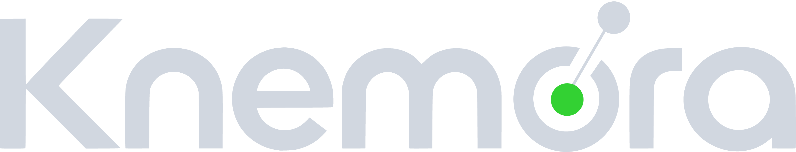
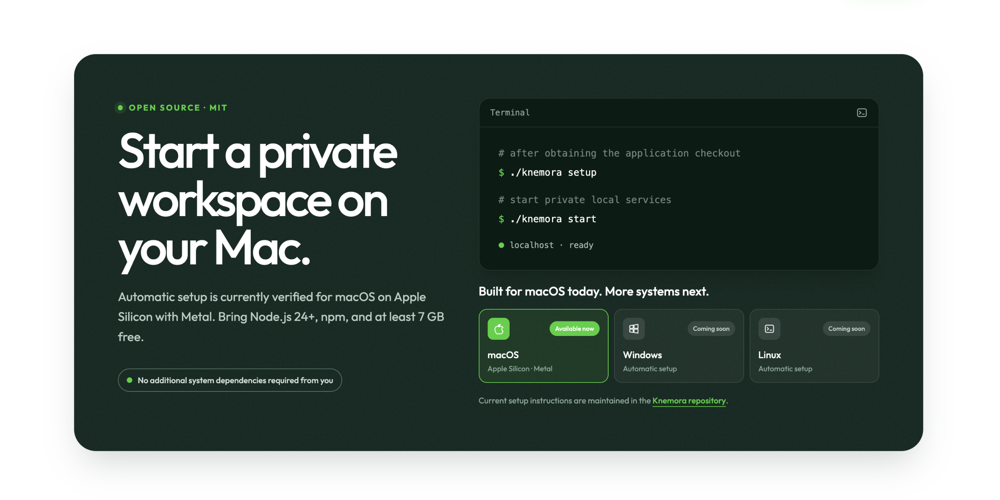
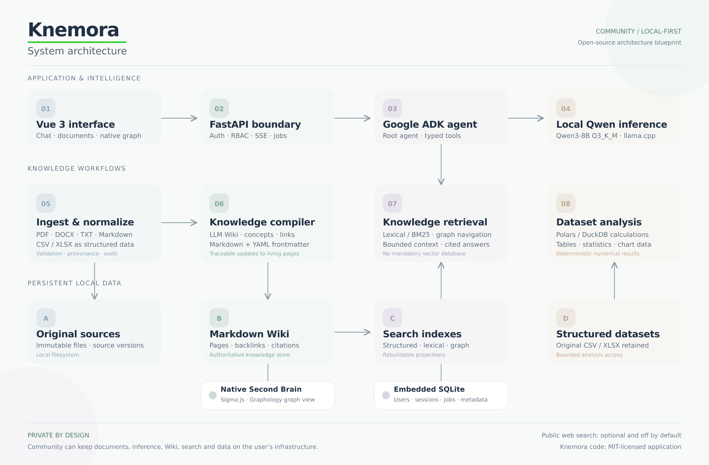
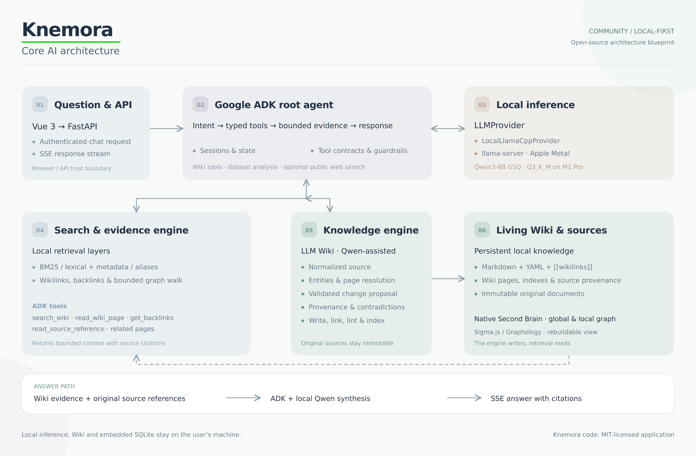

<div align="center">

<picture>
  <source media="(prefers-color-scheme: dark)" srcset="docs/assets/knemora-logo-white.png">
  <source media="(prefers-color-scheme: light)" srcset="apps/web/public/knemora-logo.svg">
  
</picture>

### Open-source, Local-first AI (SI) Second Brain

<p>
  
  
  
  
  
  
  
</p>

</div>

Knemora is an open-source, local-first knowledge and agent platform with a native Second Brain
graph, a portable Markdown Wiki, and local AI (SI) inference. It works without a mandatory cloud
service, external LLM API, vector database, or desktop knowledge application.

This repository is prepared for its first public release, `v0.1.0-alpha`. It is alpha software
intended for early testing and feedback; a future `v1.0.0` is planned after further development,
with no release date announced.

## What is Knemora?

```text
documents + data
      ↓
knowledge compilation
      ↓
living Markdown Wiki
      ↓
native Second Brain graph
      ↓
private search, chat, and analysis
```

**Knemora Open-Source includes:**

- local document ingestion for PDF, TXT, Markdown, DOCX, CSV, and XLSX;
- immutable source storage and claim-level provenance;
- a portable LLM Wiki using Markdown, YAML frontmatter, wikilinks, and relative Markdown links;
- a native Sigma.js/Graphology Second Brain with global and local graph views;
- lexical/BM25 search and bounded graph navigation without mandatory embeddings;
- local Qwen inference through llama.cpp behind a provider-neutral boundary;
- deterministic Polars-based dataset analysis and chart-ready results;
- authenticated sessions, backend RBAC, audit events, and content-free observability;
- backup, restore, migration, and Wiki maintenance workflows.

These capabilities are part of the current open-source application. There is no separate commercial
edition, feature paywall, licensing server, subscription, or silent telemetry.

## Requirements (macOS Apple Silicon)

The upcoming public alpha supports managed setup on native macOS Apple Silicon with Metal. Install:

- **Required:** Node.js 24 or newer with npm, from [nodejs.org](https://nodejs.org/) or another
  trusted distribution. Knemora does not install or change Node globally.
- **Acquisition only:** Git when using the documented `git clone` route.
- **Disk:** at least 7 GB free for the 4.12 GB default GGUF, staged/downloaded runtime components,
  application packages, and working data. Additional source documents and backups need more space.

The launcher verifies and manages uv 0.11.22, CPython 3.13.14, llama.cpp b11146 and its complete
library payload, locked application dependencies, and the selected model in application-owned
locations. Initial setup needs network access for runtime, package, and model downloads; prepared
start and private local operation do not check release hosts or require a hosted service. This is
managed local runtime installation, not a claim that Knemora is dependency-free or already
cross-platform.

## Quick start — Zero-Config



Zero-Config means Knemora performs managed setup with sensible defaults, installs its Python and
inference runtimes into application-owned locations, and requires no manual configuration for the
standard onboarding path. Node.js 24 with npm remains a prerequisite, and the first setup performs
the downloads described above.

Acquire the application checkout separately:

```bash
git clone https://github.com/federicolaterra/knemora.git
cd knemora
```

Then prepare and start the private local application with the two explicit commands:

```bash
./knemora setup
./knemora start
```

The canonical checkout directory is `knemora`. When renaming or moving an existing checkout, stop
managed services first and run `./knemora setup` once from the new location. Setup rebuilds
location-bound Python console scripts against Knemora's managed interpreter while preserving `.env`
and all application data under `~/.knemora`.

Running `./knemora` without a subcommand remains the interactive entry point. On first launch it
displays the Knemora welcome screen and offers either the normal local environment or the isolated
Development demo; the explicit commands above provide the same standard setup and start path.
Additional lifecycle commands include:

```bash
./knemora start --with-presets
./knemora delete --presets
./knemora status
./knemora logs
./knemora doctor
./knemora update --check
./knemora update
./knemora stop
./knemora backup
./knemora backups
./knemora uninstall --preserve-data
```

Automation can use `--non-interactive --yes --no-open`. Setup is idempotent, configuration values
already present in `.env` are preserved, and stop/restart never delete data. The UI is available at
`http://localhost:5173` after either start command reaches `READY`.

## System and AI (SI) Core Architecture

Knemora runs a Vue 3 interface against an authenticated FastAPI boundary on the local machine.
Google ADK provides bounded root-agent orchestration through typed application tools, while a
provider-neutral boundary serves the default Qwen3-8B model through local llama.cpp inference.
Document and dataset ingestion compile durable knowledge into a portable Markdown Wiki with YAML
frontmatter, explicit links, immutable-source references, and claim-level provenance. Sigma.js and
Graphology render the native Second Brain from rebuildable indexes, while SQLite and application
files keep operational data, sources, datasets, and knowledge local.





## Updates

Knemora checks the source-controlled official repository's `master` branch as its stable channel;
GitHub Releases are not required. The first update for an installation created before this feature
must still be performed manually, followed by `./knemora setup`. Later updates can be checked and
explicitly installed from either the CLI or the administrator sidebar card.

Checks identify both application version/tag and commit SHA. They may update Git fetch metadata and
the namespaced `refs/knemora/updates/master` ref, but do not modify application files, install
dependencies, migrate data, or restart services. Automatic checks run at most once per 24 hours
after login and can be disabled with `KNEMORA_UPDATE_CHECK_ENABLED=false`. Checks contact GitHub but
send no documents, prompts, Wiki content, conversations, or private knowledge.

Installation is supported only for a clean macOS Apple Silicon `master` checkout that is behind
official `master`. Development, custom, detached, dirty, ahead, diverged, and unsupported installs
remain check-only. The independent updater pins the confirmed SHA, prepares a sibling checkout,
takes a validated portable backup, retains the prior checkout, runs existing guarded migrations,
restarts, and verifies readiness. See [Upgrading Knemora](docs/open-source/upgrading.md) for exact
states, exit codes, journal paths, privacy details, and recovery.

Fresh installations use the embedded database at `~/.knemora/data/knemora.db`; no separate database
service is required. Supported legacy import guidance remains in the
[public installation guide](docs/open-source/installation.md#migrating-an-existing-postgresql-installation).

`KNEMORA_HOME` is a stable user-owned application home, independent of checkout and launcher
technology. `config/home.json` records its versioned compatibility contract; `config/runtime.json`
tracks rebuildable managed executables separately. Setup adopts recognized older homes without
moving their database, Wiki, sources, datasets, models, configuration, or IDs. Unknown, corrupt, or
newer homes are refused before writes with recovery guidance. Future executable or desktop hosts
must reuse this home and the existing core/migration services rather than creating a second data
root. See
[Application data and lifecycle](docs/open-source/installation.md#application-data-and-lifecycle).

Originals remain isolated below `sources/YYYY-MM-DD/<document-id>/<version-id>/`, but their leaf
names are recognizable: for example, `Relazione tecnica 2026.pdf` is stored as
`Relazione_tecnica_2026.pdf`. The exact uploaded name remains display/provenance metadata. Legacy
`original.<ext>` files are checksum-verified and renamed through a restart-safe migration without
changing source IDs or bytes.

Deleting a source in **Documents** covers every version of that document. Acceptance immediately
excludes it from downloads, datasets, search, graph, Wiki retrieval, and new answers, then a durable
local job removes its citations/unsupported generated knowledge, rebuilds projections, purges the
version directories, and cleans relational metadata. Shared claims keep independently supported
citations. Failed jobs remain excluded and can be retried from the Documents status UI. Historical
conversations and independent backups are not rewritten.

## Workspace lists and conversation history

Workspace browsing uses bounded server-side lists: Documents and Ingestion show 10 records per
page, Knowledge shows 8, and the Available datasets panel shows 5. Overview requests only the five
newest active sources. Search and filters are applied before authorized counts and pagination, and
the shared pager displays fixed groups of at most five numbered pages with one-page Prev/Next
navigation.

AI (SI) Chat keeps the eight most recently active conversations in its existing aside. **View all** opens
the authenticated `/chat/conversations` history table with server-side title search and 15 records
per page. Conversation titles can be renamed inline; otherwise the first persisted user prompt
provides a deterministic title without an external model call. Persisted prompt timestamps are
grouped by the prompt's local calendar day and rendered in the browser timezone.

## Portable backups

Full backups default to `~/Documents/Knemora/Backups/` and include a consistent SQLite snapshot,
the Knowledge Wiki, immutable originals and attachments, dataset artifacts, checksummed inventory,
and portable model configuration. GGUF files and secrets are excluded.

```bash
./knemora backup                 # --full is the default
./knemora backup --db-only
./knemora backup --path ~/Dropbox/Knemora
./knemora backups
./knemora restore BACKUP_ID_OR_ARCHIVE_PATH
./knemora backup delete BACKUP_ID
./knemora config backup-path
```

Custom backup paths persist. Restore validates the complete archive before replacement and creates
an external recovery archive first. Database-only restore preserves file data and requires an
explicit `--allow-db-only` acknowledgement when Wiki/source files exist. See the
[backup and restore guide](docs/open-source/backup-and-restore.md).

## Model management

Knemora keeps model import separate from model selection. `models` inspects the effective local
registry, `load` imports and validates one external GGUF, and `setup --model` selects only a model
that is already registered.

Use a Knemora-curated, checksum-pinned model directly:

```bash
./knemora models
./knemora setup --model qwen3-8b-q3-k-m
```

Or import a user-provided Hugging Face GGUF, note the generated Knemora ID, then select it:

```bash
# Syntax example; verify the repository, artifact, and license before use.
./knemora load --model hf:owner/Example-GGUF:Q3_K_M
./knemora models
./knemora setup --model example-q3-k-m
```

Imports resolve exactly one `.gguf` or fail on no match/ambiguity, download through a resumable
partial file, validate size/checksum/GGUF headers, and persist metadata under
`~/.knemora/config/models.json`. Imported models are shown as `User / Custom`, are never described
as Knemora-tested, and are not selected automatically. They remain subject to their upstream model
licenses; Knemora's MIT License does not relicense model weights. For automation, place the global
flags before the command: `./knemora --non-interactive --yes load --model hf:...`.

`./knemora model info <id>` shows provenance and local status. Removal is deliberately two-stage:

```bash
./knemora model remove <id>
./knemora model remove <id> registry
```

The first command removes only local artifact data. The second removes the registry entry and is
accepted only after artifact data is gone. Curated removal is recorded as a persistent local
suppression—the source-controlled definition is not edited—and the required default definition
cannot be removed. Active models must first be replaced with `setup --model <other-id>`.

## Try Knemora with demo knowledge

```bash
./knemora start --with-presets
```

This creates an isolated, entirely synthetic Northstar Labs `Development` environment with 120
interconnected, provenance-bearing Wiki pages. A stage progress bar reports database, preset, and
service readiness. Existing valid assets under `~/.knemora/demo/development` are validated in one
pass and loaded instead of being compiled again; missing assets are created once. The demo UI is
read-only: source upload, ingestion mutations, Wiki compilation, and dataset analysis are disabled.
Ask the copyable prompt shown in the demo UI:

> Which gateway, owner, policy, and freeze day apply to ORBIT-LANTERN? Cite sources.

A general-purpose chatbot without this fictional corpus has no authoritative way to know the
answer. Knemora can retrieve the seeded private context and cite its sources; this demonstrates
grounding, not a claim that Knemora's base model is intrinsically smarter. Open the **Second Brain**
page to inspect the same demo Markdown links used by search and chat.

## Native Second Brain

Open **Second Brain** in the main navigation after startup. The Global Graph contains every
eligible Markdown page and resolved explicit page link. Local Graph accepts a searchable root page
and traverses incoming and outgoing links for one, two, or three hops while preserving edge
direction. Search can focus a node or open its native Wiki Detail page; filters use real page type,
tag, and folder metadata.

**Expand** opens an immersive viewport layout with Global/Local Graph tabs, Find a page, Filters,
and Legend on the left and the complete graph toolbar above the canvas. The page itself stays fixed
while the left panel gains its own scrollbar only when needed. **Minimize** or `Escape` returns to
the normal workspace.

The graph is a derived view, not another authoritative store. Compilation refreshes the existing
Wiki revision, and the graph index also detects supported external Markdown edits by safe relative
path, size, and modification time. **Refresh** forces a rebuild and reports its freshness. Links in
fenced or inline code, images, attachments, and external URLs are ignored. Ambiguous and unresolved
page links are counted without creating fake nodes. If WebGL is unavailable, Knemora presents an
accessible searchable page list with the same native detail navigation.

## Explicit public web search

Chat remains private/local by default and public search is disabled by default. Enable it for one
managed runtime profile with either command:

```bash
./knemora start --yes-web-search
./knemora start --with-presets --yes-web-search
```

Even when enabled, the current prompt must explicitly ask to search the web, internet, online,
external, current, or outside-the-Wiki sources before the agent may use its bounded `search_web`
tool. Only the public search query leaves the machine; private Wiki pages, source records,
credentials, and internal IDs are excluded. External titles/snippets are treated as untrusted,
shown separately from Wiki evidence, and cited with their returned URLs.

Public search uses DDGS with a DuckDuckGo backend and requires network access. A normal launch
without the flag forces `KNEMORA_WEB_SEARCH_ENABLED=false`; result and timeout bounds are
controlled by `KNEMORA_WEB_SEARCH_MAX_RESULTS` and `KNEMORA_WEB_SEARCH_TIMEOUT_SECONDS`.

## Google ADK developer playground

After Knemora and its local model server are running, launch the optional official ADK Web UI in a
separate terminal:

```bash
./knemora --dev adk-web
```

The command imports the existing `knowledge_agent` from the locked `apps/api/.venv`; it does not
create another agent. It binds only to `127.0.0.1`, prints the selected URL, and runs in the
foreground until Ctrl+C. The expected URL is `http://localhost:8080` when port 8080 is free and is
not configured for another Knemora service. Otherwise the launcher selects an available port in
8080–8090. If that listener is already a Knemora ADK Web instance, the command reports its URL
instead of starting a duplicate; other listeners are never stopped or replaced.

Use the playground's own chat to inspect its Events and Trace views. Requests sent through the
normal Knemora UI use a separate FastAPI/ADK execution path and do not automatically appear there.
The playground is a local, unauthenticated development server and is never started by normal
`./knemora start`. Add `--yes-web-search` after `adk-web` only when public-search testing is needed.

To reclaim only the preset files and their isolated database, run `./knemora delete --presets` and
confirm the prompt (or use `./knemora --yes delete --presets`). The downloaded model, normal Wiki,
normal sources, and normal database are preserved.

The former `start-with-presets` and `delete-presets` spellings remain deprecated compatibility
aliases. They print the corresponding canonical command and route through the same implementation.

## Uninstall

Uninstall always requires an explicit `y` or `yes` response in an interactive terminal. Before
prompting, Knemora prints the absolute repository and configured application-data paths and the
full deletion scope. `--yes` cannot bypass this confirmation.

```bash
./knemora uninstall                  # remove the repository and application data
./knemora uninstall --preserve-data  # remove only the repository
```

Both commands remove uncommitted and untracked files inside the checkout. The default command also
removes the entire configured Knemora runtime directory (normally `~/.knemora`), including the
database, configuration, models, Wiki, sources, datasets, logs, and demo data. Portable backups
outside the repository and application-data directory are preserved, as are shared dependencies
and external symlink targets. With `--preserve-data`, a fresh clone can reuse the retained data by
keeping the same `KNEMORA_HOME`, then running `./knemora setup` and `./knemora start`.

## Repository map

```text
apps/api/             FastAPI, Google ADK, domain services, migrations
apps/web/             Vue 3, Vite, and TypeScript product interface
knowledge/            Live portable Markdown Wiki and rebuildable graph index
infrastructure/       Local runtime, backup, restore, and audit scripts
packages/             Reserved for justified shared packages
docs/                 Public guides, architecture references, and examples
tests/                 Cross-application test contracts
```

## Manual development setup

Prerequisites: Python 3.12+, `uv`, Node.js 24, and npm. The repository
root includes `.nvmrc` and `.node-version` defaults for the supported Node major.

```bash
cp .env.example .env
# Replace KNEMORA_BOOTSTRAP_ADMIN_PASSWORD in .env.
make setup
make db-migrate
make api-dev
```

In another terminal:

```bash
make web-dev
```

Open `http://localhost:5173`. The API health endpoint is
`http://localhost:8000/api/v1/health`.

The full local release can also be started with `make app-start` after configuring llama.cpp and a
compatible GGUF. For an explicit no-inference operations drill, use:

```bash
KNEMORA_SKIP_LLM=1 make app-start
```

## Documentation

- [Installation](docs/open-source/installation.md)
- [Architecture](docs/open-source/architecture.md)
- [Local inference](docs/open-source/local-inference.md)
- [Ingestion and provenance](docs/open-source/ingestion.md)
- [Knowledge Engine](docs/open-source/knowledge-engine.md)
- [Second Brain and Wiki](docs/open-source/wiki.md)
- [Security and privacy](docs/open-source/security.md)
- [Backup and restore](docs/open-source/backup-and-restore.md)
- [Upgrading](docs/open-source/upgrading.md)
- [Development](docs/open-source/development.md)
- [Development demo preset](docs/demo/development-preset.md)

## Contributing and security

See [Contributing](.github/CONTRIBUTING.md), the [Code of Conduct](.github/CODE_OF_CONDUCT.md), and
the [security policy](.github/SECURITY.md). Third-party licensing is summarized in
[Third-party notices](docs/open-source/THIRD_PARTY_NOTICES.md), and release history is recorded in
the [changelog](docs/open-source/CHANGELOG.md).

## License

Knemora is open-source software licensed under the MIT License.

See [LICENSE](./LICENSE) for details.
